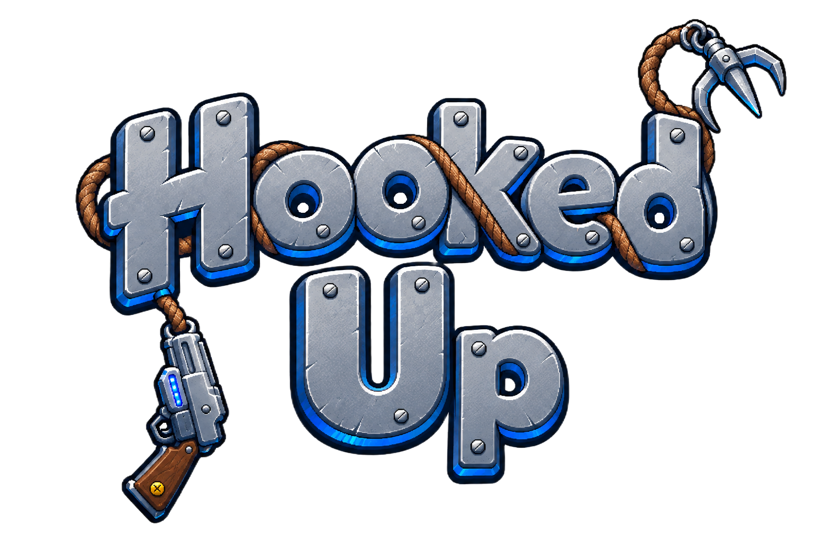

  

# _Hooked Up_

Dr. Gánchez es un científico con unas ideas bastante locas. ¿Su último invento? El megaexplosionador, con el que planea impresionar a su compañera de laboratorio, la Dra. Isabella, con un asombroso espectáculo de fuego, luces y colores. Sin embargo, un fallo en el descombobulador nitroplásico provoca una explosión antes de tiempo que lo despide al fondo del sistema de residuos del complejo.

Por suerte, en las profundidades encuentra uno de sus primeros experimentos, descartado tiempo ha: el gancho. ¿Logrará el Dr. Gánchez escapar del abismo, regresar al laboratorio y declarar su amor? Descúbrelo en esta aventura de plataformas y puzles en 2D, donde deberás usar el gancho para balancearte, impulsarte y atraer objetos para atravesar los obstáculos que te separan de tu querida doctora.

El juego está hecho con [Godot 4.7](https://godotengine.org/), utilizando GDScript.

## Sobre el proyecto

_Hooked Up_ es mi Trabajo de Fin de Grado en la [Universitat Oberta de Catalunya (UOC)](https://www.uoc.edu/). Soy Yerai Rodríguez Gonzalez, desarrollador de _software_ y un gran amante de los videojuegos. Después de una vida entera al otro lado de la pantalla, ha llegado la hora de cruzarla y cumplir un sueño: diseñar y desarrollar mi propio videojuego.

## Estado actual: Prototipo 1 (v0.1.0)

El primer prototipo está pensado para evaluar una sola cosa: si balancearse con el gancho resulta divertido y se controla bien. Incluye:

- Dos niveles con dificultad creciente.
- Obstáculos que solo se superan encadenando balanceos entre superficies enganchables.
- Plataformas móviles y superficies enganchables, tanto estáticas como en movimiento.
- Checkpoints y reinicio rápido.

Todavía no hay sonido ni partículas, y la historia aún no está en el juego: el prototipo solo incluye dos niveles de prueba. Las mecánicas de atraer objetos con el gancho e impulsarte hacia el punto de enganche llegarán en fases posteriores.

## Cómo jugar

Descarga la última versión para tu sistema (Windows, macOS o Linux) desde [Releases](../../releases/latest). Las instrucciones de ejecución de cada sistema están en las notas de la release.

### Controles

El prototipo se juega con teclado y ratón (no hay soporte de mando).

| Acción | Control |
|---|---|
| Moverse | A / D o flechas izquierda / derecha |
| Saltar | W, flecha arriba o Espacio |
| Gancho | Botón izquierdo del ratón (mantener pulsado para seguir enganchado) |
| Reiniciar desde el último checkpoint | R |
| Salir (en la pantalla final) | Esc |

El gancho se lanza hacia donde apunta el ratón, tiene un alcance limitado y solo se engancha a las superficies marcadas como enganchables. La mirilla cambia de aspecto para indicar si el objetivo se puede enganchar.

## Créditos

- Motor: [Godot Engine](https://godotengine.org/license), con licencia MIT.
- Tiles de plataformas: [Pixel Platformer](https://kenney.nl/assets/pixel-platformer) y [Pixel Platformer Industrial Expansion](https://kenney.nl/assets/pixel-platformer-industrial-expansion), de Kenney (CC0).
- Fondo del nivel 2: [Free Industrial Zone Tileset Pixel Art](https://craftpix.net/freebies/free-industrial-zone-tileset-pixel-art/), de CraftPix ([licencia de CraftPix para productos gratuitos](https://craftpix.net/file-licenses/)).
- Iconos de controles: Input Prompts, de [Kenney](https://kenney.nl/assets/input-prompts) (CC0).
- Mirilla: [Kenney](https://kenney.nl/assets/crosshair-pack) (CC0).
- Fuente: [Kenney](https://kenney.nl/assets/kenney-fonts) (CC0).
- Textura metálica de fondo de las pantallas de inicio y fin: [ambientCG](https://ambientcg.com/view?id=Metal038) (CC0).
- Logo: generado con IA (ChatGPT).
- Personaje y arma: diseño propio, hecho con Aseprite.
