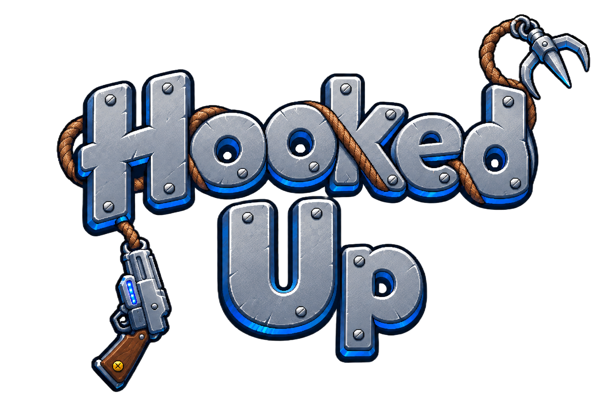

  

# _Hooked Up_

Dr. Gánchez es un científico con unas ideas bastante locas. ¿Su último invento? El megaexplosionador, con el que planea impresionar a su compañera de laboratorio, la Dra. Isabella, con un asombroso espectáculo de fuego, luces y colores. Sin embargo, un fallo en el descombobulador nitroplásico provoca una explosión antes de tiempo que lo despide al fondo del sistema de residuos del complejo.

Por suerte, en las profundidades encuentra uno de sus primeros experimentos, descartado tiempo ha: el gancho. ¿Logrará el Dr. Gánchez escapar del abismo, regresar al laboratorio y declarar su amor? Descúbrelo en esta aventura de plataformas y puzles en 2D, donde deberás usar el gancho para balancearte, recoger y soltar cuerda y accionar poleas para atravesar los obstáculos que te separan de tu querida doctora.

El juego está hecho con [Godot 4.7](https://godotengine.org/), utilizando GDScript.

## Sobre el proyecto

_Hooked Up_ es mi Trabajo de Fin de Grado en la [Universitat Oberta de Catalunya (UOC)](https://www.uoc.edu/). Soy Yerai Rodríguez Gonzalez, desarrollador de _software_ y un gran amante de los videojuegos. Después de una vida entera al otro lado de la pantalla, ha llegado la hora de cruzarla y cumplir un sueño: diseñar y desarrollar mi propio videojuego.

## Estado actual: Alpha (v0.2.0)

La alpha es una demo de un único nivel, con las mecánicas prácticamente definitivas y pensada para jugarse sin explicaciones previas. Incluye:

- Un nivel completo que enseña cada mecánica paso a paso, con carteles de controles integrados en el escenario, y termina en una carrera contrarreloj.
- Balanceo entre ganchos, cuerda regulable (recoger y soltar) y salto con un pequeño margen de tolerancia al caer de un borde.
- Poleas que abren compuertas mientras estás colgado de ellas y las cierran poco a poco al soltarte.
- Plataformas y ganchos en movimiento.
- Checkpoints en forma de bandera y vuelta rápida a la última bandera.
- Música original, efectos de sonido y partículas.
- Menú principal, menú de pausa, opciones (volumen de música y efectos, cámara que sigue al ratón) y pantalla final.

La historia aún no está en el juego: llegará en fases posteriores.

La versión anterior, el [prototipo 1 (v0.1.0)](../../releases/tag/v0.1.0), servía para evaluar si balancearse con el gancho resultaba divertido.

## Cómo jugar

Descarga la última versión para tu sistema (Windows, macOS o Linux) desde [Releases](../../releases/latest). Las instrucciones de ejecución de cada sistema están en las notas de la release.

### Controles

El juego se juega con teclado y ratón (no hay soporte de mando).

| Acción | Control |
|---|---|
| Moverse | A / D o flechas izquierda / derecha |
| Saltar | Espacio o flecha arriba |
| Gancho | Botón izquierdo del ratón (mantener pulsado para seguir enganchado) |
| Recoger / soltar cuerda | W / S (estando enganchado) |
| Volver a la última bandera | R |
| Pausa | Esc |

El gancho se consigue poco después de empezar el nivel. Se lanza hacia donde apunta el ratón, tiene un alcance limitado y solo se engancha a los ganchos del escenario. La mirilla cambia de aspecto para indicar si el objetivo se puede enganchar.

## Créditos

El juego está hecho con [Godot Engine](https://godotengine.org/license) (licencia MIT). El personaje y el arma son de diseño propio. El logo y la música se han generado con IA (ChatGPT y Suno, respectivamente).

La lista completa de recursos de terceros (arte, efectos de sonido y música), con sus autores y licencias, está en [CREDITS.md](CREDITS.md).
